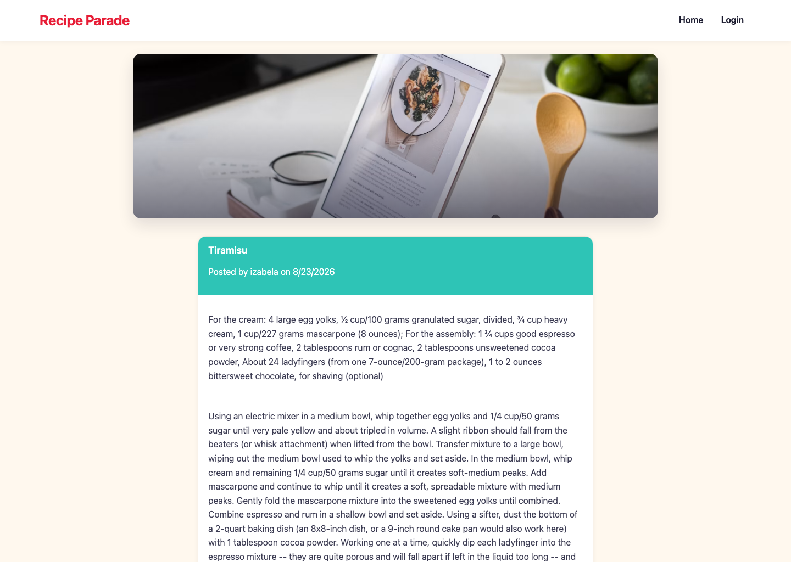

# Recipe Parade

## Description

The Recipe Parade is an application where the users can sign up and the manage the recipes. The users will be able to view the database of recipes, add new recipes, add recipes to their favorite recipes and rate the recipes. This application follows the MVC paradigm and it is using Handlebars.js as the templating language, Sequelize as the ORM, and the express-session and passport npm package for authentication.

## Table of Contents

* [Deployed Application](#deployed-application)
* [User Story](#user-story)
* [Usage](#usage)
* [Local Setup](#local-setup)
* [License](#license)
* [Contributing](#contributing)
* [Questions](#questions)


## Deployed Application 

Not currently deployed. Previously hosted on [Railway](https://railway.app/) with a managed MySQL database (and before that on Heroku, which discontinued its free tier); the Railway project was removed to free up a resource slot for another app. See [Local Setup](#local-setup) below to run it yourself.




## User Story 
AS A cooking lover and foodie<br />
I WANT a CMS-style recipe site<br />
SO THAT I can publish recipes, comment on recipes, add recipes to favorites, rate recipes and manage my own recipes<br />
GIVEN a Recipe Parade site<br />
WHEN I visit the site for the first time<br />
THEN I am presented with the homepage, which includes existing recipes if any have been created; navigation links for the homepage and the dashboard of my recipes; and the option to log in<br />
WHEN I click on the homepage option<br />
THEN I am taken to the homepage<br />
WHEN I click on any other links in the navigation<br />
THEN I am prompted to either sign up or sign in<br />
WHEN I choose to sign up<br />
THEN I am prompted to create a username and password<br />
WHEN I click on the sign-up button<br />
THEN my user credentials are saved and I am logged into the site<br />
WHEN I revisit the site at a later time and choose to sign in<br />
THEN I am prompted to enter my username and password<br />
WHEN I am signed in to the site<br />
THEN I see navigation links for the homepage, the dashboard, and the option to log out<br />
WHEN I click on the homepage option in the navigation<br />
THEN I am taken to the homepage and presented with existing recipes that include the recipe title, ingredients and the directions for preparation<br />
WHEN I click on an existing recipe<br />
THEN I am presented with the recipe title, ingredients, recipe creator’s username, and date created for that recipe and have the option to leave a comment and add a rating.<br />
WHEN I am viewing the recipe I am also able to rate recipes with range 1-5 (5 being the best)<br />
WHEN I am viewing the recipe I am able to save the recipe to my favorite recipe list.<br />
WHEN I enter a comment and click on the submit button while signed in<br />
THEN the comment is saved and the recipe is updated to display the comment, the comment creator’s username, and the date created<br />
WHEN I click on the dashboard option in the navigation<br />
THEN I am taken to the dashboard and presented with any recipes I have already created and the option to add a new recipe<br />
WHEN I click on the button to add a new recipe<br />
THEN I am prompted to enter a title, ingredients and directions of preparation for my recipe<br />
WHEN I am editing my recipe, I am able to tag the recipe for various categories.<br />
WHEN I click on the button to create a recipe<br />
THEN the title, ingredients and directions of preparation of my recipe are saved and I am taken back to an updated dashboard with my recipe<br />
WHEN I click on one of my existing recipes in the dashboard<br />
THEN I am able to delete or update my recipe and taken back to an updated dashboard<br />
WHEN I click on the logout option in the navigation<br />
THEN I am signed out of the site<br />
WHEN I am idle on the page for more than a set time<br />
THEN I am automatically signed out of the site<br /> 

## Usage
The Recipe Parade is an application where the users can sign up and the manage the recipes. The users will be able to search the database of recipes, add new recipes, save recipes to their favorites and rate and comment on recipes.

## Local Setup

This app requires Node.js 18+ and a MySQL database.

1. Install dependencies: `npm install`
2. Create a MySQL database (e.g. `CREATE DATABASE recipe_parade;`)
3. Create a `.env` file with:

   ```text
   DB_NAME=recipe_parade
   DB_USER=your_mysql_user
   DB_PW=your_mysql_password
   ```

4. Seed the database: `npm run seed`
5. Start the server: `npm start` (or `npm run watch` for auto-reload during development)
6. Visit `http://localhost:3001`

## License

This project is licensed under the MIT.

## Contributing

Anisha Sinha, Trent Geraty and Izabela Petrovicova


## Questions

If you have any questions about the repository, contact us directly at anishaspubnet@gmail.com, trentgeraty@yahoo.com or i.petrovicova@gmail.com. 